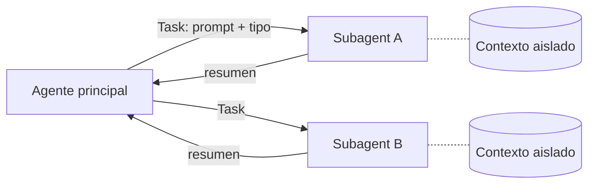

<Eyebrow>M2 · Subagents</Eyebrow>

## Cómo funciona el Task tool

<Callout>Cada subagent tiene **su propia ventana de contexto** y solo regresa un resumen.</Callout>

<Notes>
- En versiones recientes de Claude Code la herramienta aparece como Agent tool; es el mismo mecanismo.
- Beneficio principal: el contexto del agente principal no se llena con la exploración.
- Los subagents no hablan entre sí: todo pasa por el principal. Eso cambia con Agent Teams (M3).
</Notes>
