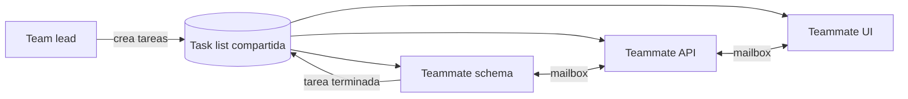

<Eyebrow>M3 · Coordinación</Eyebrow>

## Mailbox y task list compartida

<Callout>El lead **reparte y verifica**; los teammates **reclaman, avisan y entregan**.</Callout>

<Notes>
- Ejemplo de mensaje útil: "schema listo, la columna se llama min_stock, integer, default 0".
- Observen el mailbox en vivo durante el lab: ahí se ve si el contrato entre tareas es claro.
</Notes>
